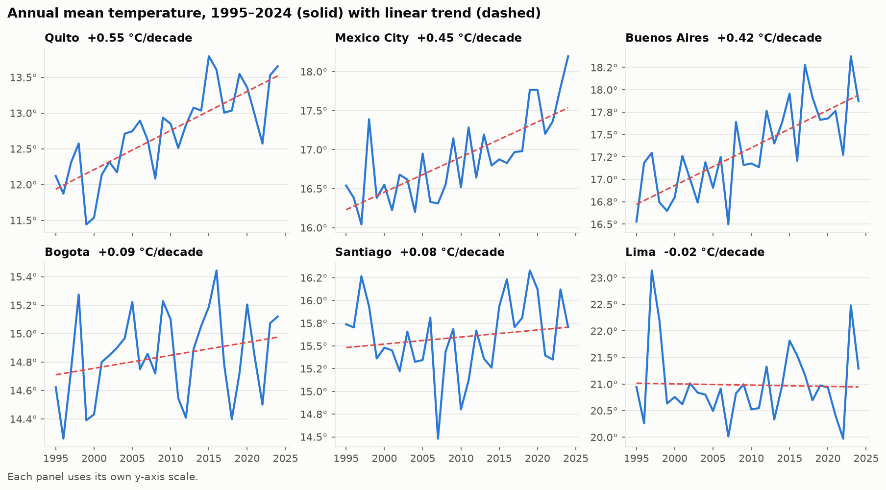
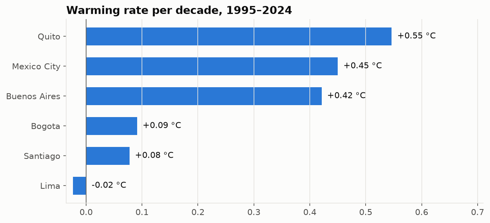
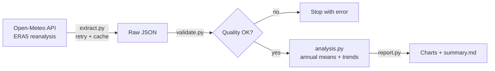

# Latin America Climate Trends


How much have Latin American capitals warmed in the last 30 years? This project pulls **65,748 daily
observations (1995–2024)** for six capitals from the [Open-Meteo historical weather API](https://open-meteo.com/en/docs/historical-weather-api),
validates them, and measures each city's warming trend.

## Key findings

| City | Trend (°C per decade) | 1995–2004 → 2015–2024 |
|---|---:|---:|
| Quito | **+0.55** | +1.19 °C |
| Mexico City | **+0.45** | +0.87 °C |
| Buenos Aires | **+0.42** | +0.86 °C |
| Bogota | +0.09 | +0.20 °C |
| Santiago | +0.08 | +0.26 °C |
| Lima | −0.02 | +0.01 °C |

- **5 of 6 capitals warmed.** Quito, Mexico City and Buenos Aires warmed about 0.4–0.55 °C per decade.
- **Lima stayed flat.** Its climate is moderated by the cold Humboldt Current; the spikes in 1997–98 and 2023
  match strong **El Niño** events.




Full tables: [`reports/summary.md`](reports/summary.md).

## The bug I almost shipped

The first run said **Bogota was cooling by 0.31 °C per decade**. That didn't make sense, so I looked at the
yearly values and found a sudden **−1.8 °C drop in 2017**.

The cause: the API's default `best_match` setting combines different weather models depending on the
period. When the source model changed, the series jumped. Pinning a single reanalysis model (**ERA5**)
for the full 30 years fixed it, and a test now checks that the model is always pinned.

**Lesson:** a result that looks surprising should be checked against the raw data before it's reported.

## What this project demonstrates

- **API ingestion** with retries, **exponential backoff** and **rate-limit handling** (HTTP 429 waits out the
  per-minute quota, which actually happened during the run).
- **Raw-data caching** so re-runs don't hit the API again.
- **Data quality checks** that stop the pipeline: nulls, missing dates, duplicates, impossible
  temperatures, `temp_min > temp_max`, negative rainfall.
- **Analysis:** complete-year filtering, linear regression trends, period comparison.
- **Testing:** 15 tests, including retry behavior with a fake API (no network needed in CI).

## Pipeline



## Limitations

- **Reanalysis, not weather stations:** ERA5 is a model reconstruction on a ~25 km grid. It's consistent over
  time but can differ from a city's official station, especially in mountains (Quito, Bogota) and on the
  coast (Lima's grid cell partly covers ocean).
- **Rainfall percentages for Lima** are unreliable: it barely rains there, so small changes look huge.
- **30 years is a short window** for climate trends and natural variability (El Niño / La Niña) has a
  strong effect, so the trends are descriptive, not a forecast.

## Run it

```bash
git clone https://github.com/ales45/latam-climate-trends.git
cd latam-climate-trends
python -m venv .venv
source .venv/bin/activate        # Windows: .venv\Scripts\activate
pip install -e ".[dev]"

python -m climate.pipeline   # ~2 minutes the first time (API quota), instant afterwards
pytest                       # 15 tests
```

Add a city by appending it to [`src/climate/cities.py`](src/climate/cities.py).

## Data source

Weather data by [Open-Meteo.com](https://open-meteo.com/), licensed under
[CC BY 4.0](https://creativecommons.org/licenses/by/4.0/). Underlying reanalysis: Copernicus ERA5.
